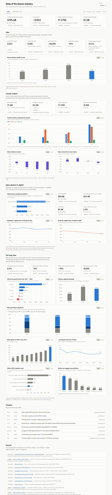
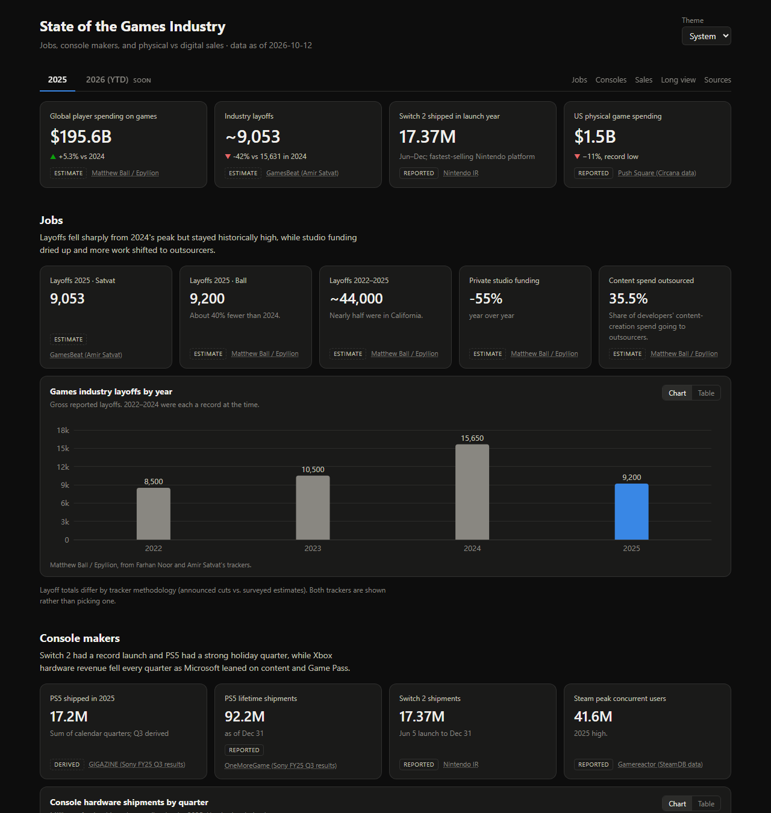
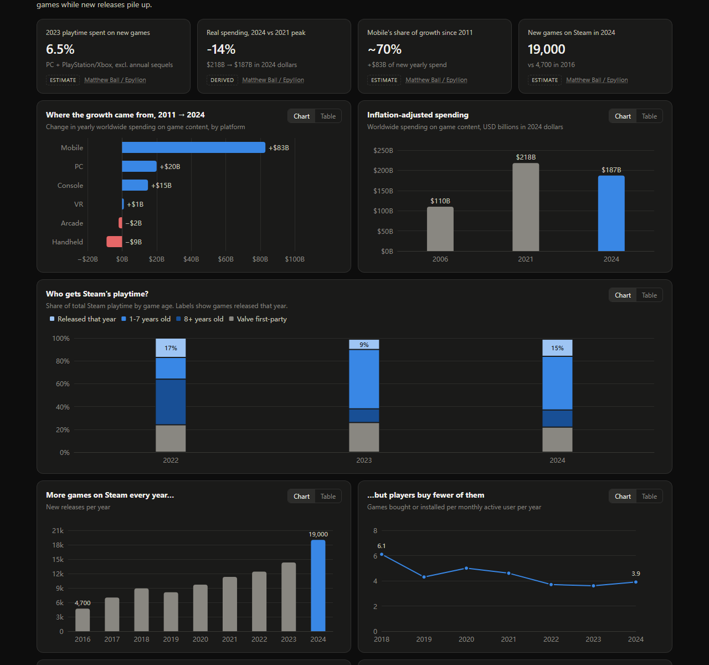

# Video Game Industry Visualization

A dashboard of the state of the games industry — jobs, console makers, and physical vs digital sales — one tab per year (2025 now, 2026 next).



<details>
<summary>Dark theme</summary>





</details>

### What's on the 2025 tab

| Section | What it shows |
|---|---|
| **Headline** | Global player spending ($195.6B, +5.3%), industry layoffs (~9,000, −42%), Switch 2 launch-year shipments (17.37M), US physical spending ($1.5B, record low) |
| **Jobs** | Layoffs by year 2022–2025 (8,500 → 10,500 → 15,650 → 9,200), layoffs by tracker, private funding (−55%), outsourcing share (35.5%) |
| **Console makers** | Quarterly hardware shipments for PS5 / Switch 2 / Switch; Xbox hardware and content & services revenue change year over year; PS5 lifetime shipments; Steam peak concurrent users |
| **Sales: physical vs digital** | Global spending by platform (mobile / console / PC); US spending (ESA/Circana); PlayStation and Nintendo digital share by quarter |
| **The long view** | Context from Matthew Ball's *State of Video Gaming* decks: where growth since 2011 came from (mobile +$83B, handheld −$9B), inflation-adjusted spending (down 14% since 2021), Steam playtime by game age, Steam releases vs games bought per player, the 6.5% of 2023 playtime spent on new games, and Roblox engagement compared with other platforms |
| **Timeline** | Key 2025 events: Switch 2 launch, Microsoft layoffs, console price increases, the EA buyout |
| **Sources** | Every source cited, marked primary or secondary |

Hover any bar or point to see its source and notes. Every chart has a **Table** toggle, and the theme follows your system setting, with a manual override.

## Run locally

```bash
npm install
npm run dev        # http://localhost:5173/#/2025
```

Stop the server with **Ctrl + C** in the terminal.

`npm run build` produces a static `dist/` folder (no server needed). `npm run preview` serves it at http://localhost:4173.

## How it's built

- **Vite + React + TypeScript**, charts with **ECharts**.
- **Data lives in `public/data/`** as JSON, one folder per year:
  - `years.json` — which tabs exist and their status (`complete` / `in-progress` / `planned`)
  - `sources.json` — every source, cited by `id`
  - `<year>/consoles.json`, `sales.json`, `jobs.json`, `context.json` (long-run context), `events.json`
- Every number is an *observation* with a `sourceId` and a `confidence`:
  - `reported` — stated in a filing or report
  - `estimate` — analyst / tracker figure
  - `derived` — our own arithmetic on reported numbers (explained in `note`); drawn hatched in charts
- Files are validated at load time with zod (`src/data/schema.ts`), and an unknown `sourceId` is an error, so nothing renders unsourced.
- Periods are **calendar** quarters (`2025-Q3`). Sony/Nintendo fiscal years end in March and Microsoft's in June; map them before entering data.

## Adding 2026

1. Create `public/data/2026/` with the same five files.
2. Set 2026 to `"in-progress"` in `years.json` with an `asOf` date.

## Data sources

Every source is listed in `public/data/sources.json` and on the dashboard's Sources section. The main ones:

- **Company reports:** Nintendo IR, Sony and Microsoft earnings (Sony and Microsoft figures via press coverage).
- **Market data:** ESA / Circana / Sensor Tower for US spending.
- **Matthew Ball / Epyllion:** [*The State of Video Gaming in 2025*](https://www.matthewball.co/all/stateofvideogaming2025) (231 slides, updated Feb 2026) and the 2026 edition. Figures are transcribed from slide labels, and each data point's note gives its slide number. The one chart whose values were read from gridlines (monthly engagement hours) is marked as approximate.

## Going to the cloud later

- **Static hosting (no code changes):** deploy `dist/` to GitHub Pages, Cloudflare Pages or Netlify. Routing is hash-based (`#/2025`), so no rewrite rules are needed.
- **An API instead of files:** set `VITE_DATA_ROOT=https://your-api/v1` at build time. `src/data/load.ts` is the only file that fetches data, and it expects the same paths.
