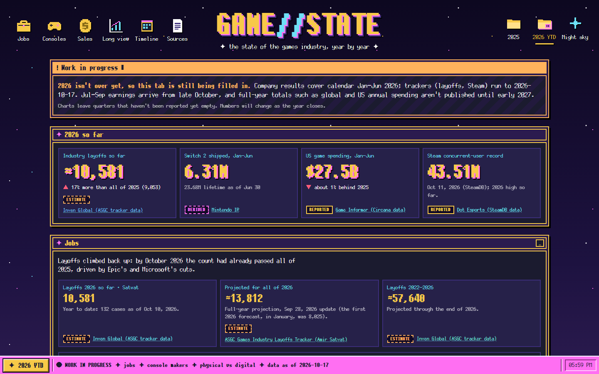
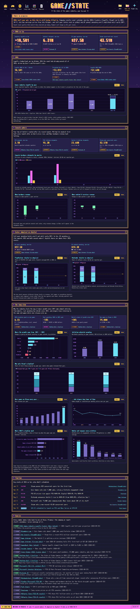
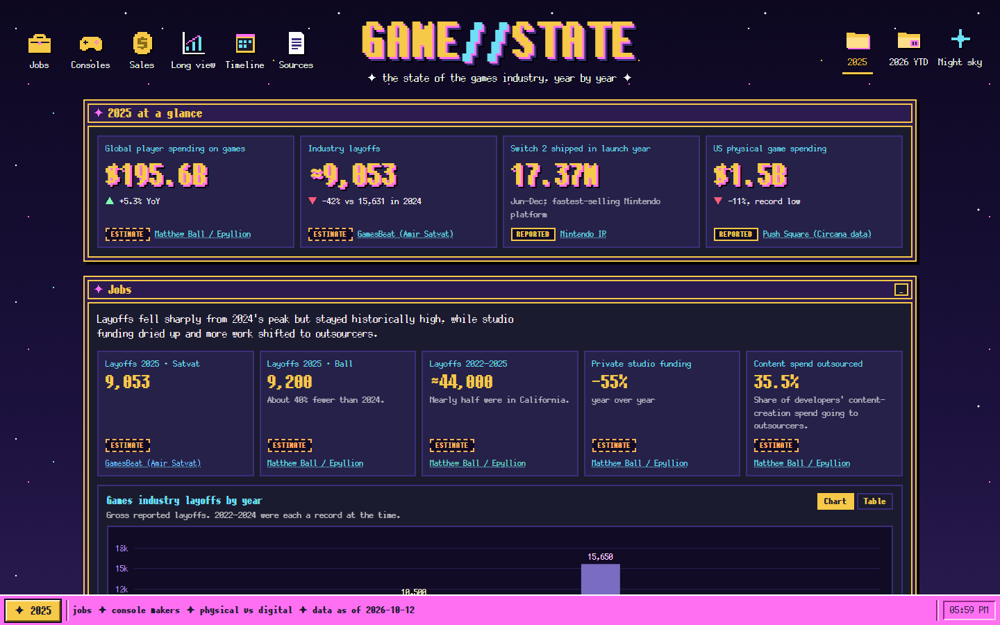
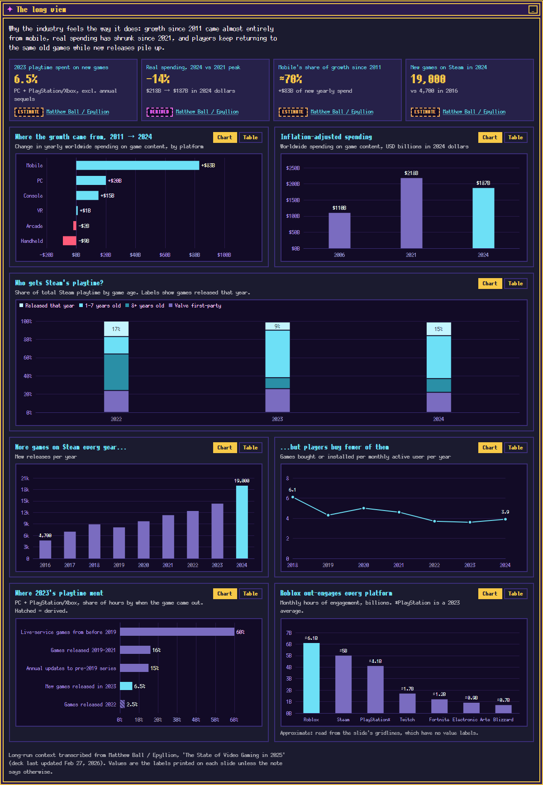
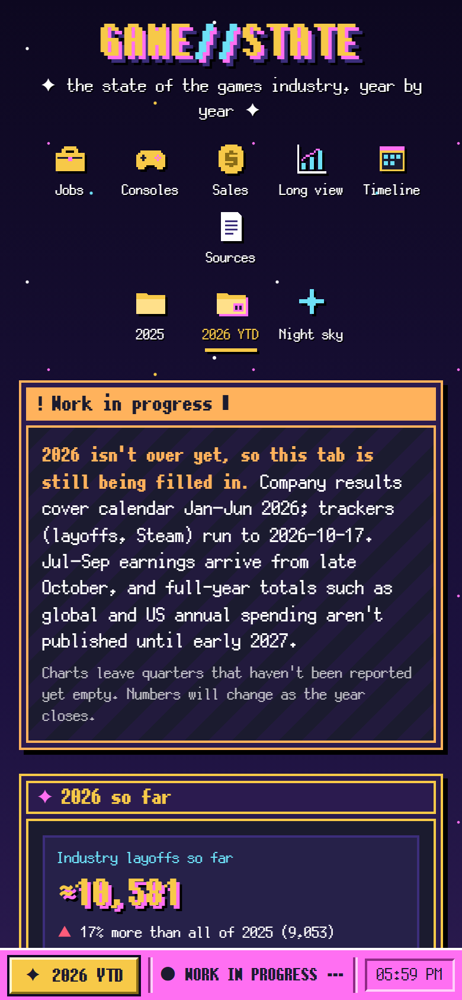

# Game//State: Video Game Industry Visualization

A dashboard of the state of the games industry (jobs, console makers, and physical vs digital sales), one tab per year. It's styled after [the1azreen.neocities.org](https://the1azreen.neocities.org/) and [polling-lag-tester-pc](https://github.com/The1Azreen/polling-lag-tester-pc): indigo windows, neon-yellow borders, teal and magenta accents, a pixel font, a night sky and a taskbar.

> [!NOTE]
> **2026 is a work in progress.** The year isn't over, so the 2026 tab covers calendar Jan–Jun company results, plus trackers (layoffs, Steam) up to Oct 17, 2026. Quarters that haven't been reported are left empty, and the tab shows a work-in-progress notice. Full-year totals (global and US annual spending) arrive in early 2027.



<details>
<summary>More screenshots: full 2026 page, 2025 tab, long view, phone</summary>









</details>

### What's on the 2026 tab (year to date)

| Section | What it shows |
|---|---|
| **Work in progress** | What the tab covers so far and what comes next (Jul–Sep earnings from late October; full-year totals in early 2027) |
| **2026 so far** | Layoffs to date (10,581 by Oct 10, already 17% above all of 2025), Switch 2 Jan–Jun shipments (6.31M), US spending Jan–Jun ($27.5B, about 1% behind 2025), Steam's new concurrent-user record (43.5M) |
| **Jobs** | Layoffs by year, 2022 → 2026 YTD, with the ASGC tracker's full-year projection (~13,812) drawn as a dashed segment |
| **Console makers** | Q1–Q2 hardware shipments: PS5 1.5M / 1.6M, Switch 2 2.49M / 3.82M, Switch 0.56M / 0.66M; Xbox hardware −33% / −13% and content & services −5% / −10% year over year; PS5 (95.3M) and Switch 2 (23.68M) lifetime shipments |
| **Sales** | US Jan–Jun spending; PlayStation digital share (85% / 82%) and Nintendo digital share (67.2%, its highest ever, then 61.5%) |
| **Timeline** | Epic's 1,000+ layoffs, PS5 and Switch 2 price rises, Microsoft's ~4,800 job cuts, Steam records, and GTA VI (Nov 19, marked *upcoming*) |

### What's on the 2025 tab

| Section | What it shows |
|---|---|
| **2025 at a glance** | Global player spending ($195.6B, +5.3%), industry layoffs (~9,000, −42%), Switch 2 launch-year shipments (17.37M), US physical spending ($1.5B, record low) |
| **Jobs** | Layoffs by year 2022–2025 (8,500 → 10,500 → 15,650 → 9,200), layoffs by tracker, private funding (−55%), outsourcing share (35.5%) |
| **Console makers** | Quarterly hardware shipments for PS5 / Switch 2 / Switch; Xbox hardware and content & services revenue change year over year; PS5 lifetime shipments; Steam peak concurrent users |
| **Sales: physical vs digital** | Global spending by platform (mobile / console / PC); US spending (ESA/Circana); PlayStation and Nintendo digital share by quarter |
| **The long view** | Context from Matthew Ball's *State of Video Gaming* decks: where growth since 2011 came from (mobile +$83B, handheld −$9B), inflation-adjusted spending (down 14% since 2021), Steam playtime by game age, Steam releases vs games bought per player, the 6.5% of 2023 playtime spent on new games, and Roblox engagement compared with other platforms |
| **Timeline** | Key 2025 events: Switch 2 launch, Microsoft layoffs, console price increases, the EA buyout |
| **Sources** | Every source cited, marked primary or secondary |

Hover any bar or point to see its source and notes. Every chart has a **Table** toggle, and every section window can be minimized with its `_` button. The **Night sky** icon starts the scrolling star background (off by default, remembered per browser, and disabled when your system asks for reduced motion).

## Run locally

```bash
npm install
npm run dev        # http://localhost:5173/#/2026
```

Stop the server with **Ctrl + C** in the terminal.

`npm run build` produces a static `dist/` folder (no server needed). `npm run preview` serves it at http://localhost:4173.

## How it's built

- **Vite + React + TypeScript**, charts with **ECharts**.
- **Theme:** one dark retro theme in `src/styles.css`, with colors as CSS variables; `src/theme.ts` reads them for the charts. The font is [PixelMplus12](https://itouhiro.github.io/PixelMplus/) (M+ FONT LICENSE), served from `public/fonts/`.
- **Data lives in `public/data/`** as JSON, one folder per year:
  - `years.json`: which tabs exist and their status (`complete` / `in-progress` / `planned`). An `in-progress` year shows the work-in-progress notice and year-to-date labels.
  - `sources.json`: every source, cited by `id`
  - `<year>/consoles.json`, `sales.json`, `jobs.json`, `context.json` (long-run context), `events.json`. Each domain file has a `lede` (the section summary) and `notes`.
- Every number is an *observation* with a `sourceId` and a `confidence`:
  - `reported`: stated in a filing or report
  - `estimate`: an analyst or tracker figure
  - `derived`: our own arithmetic on reported numbers (explained in `note`), drawn hatched in charts
- Files are validated at load time with zod (`src/data/schema.ts`), and an unknown `sourceId` is an error, so nothing renders unsourced.
- Periods are **calendar** quarters (`2026-Q2`). Sony and Nintendo fiscal years end in March and Microsoft's in June, so map them before entering data (`2026-Q2` = Sony FY26 Q1 = Nintendo FY27 Q1 = Microsoft FY26 Q4).

## Updating 2026 as the year goes on

1. Add each quarter's observations to `public/data/2026/*.json` as companies report. Charts fill the empty quarter automatically.
2. Bump `asOf` in `years.json`.
3. When the year closes and full-year data is out, add the annual metrics (`global_content_spend`, `platform_spend`, `us_spend_total`, …) and set the status to `"complete"`. The work-in-progress notice and YTD labels then go away.

## Data sources

Every source is listed in `public/data/sources.json` and in the dashboard's Sources section. The main ones:

- **Company reports:** Nintendo IR (the Aug 2026 explanatory material gives quarterly hardware, software and digital figures from Apr 2025 to Jun 2026), Microsoft IR and SEC filings, and Sony's results via press coverage.
- **Market data:** ESA / Circana / Sensor Tower for US spending.
- **Layoffs:** Amir Satvat's ASGC tracker (2025–2026), and Matthew Ball's yearly totals (2022–2025).
- **Matthew Ball / Epyllion:** [*The State of Video Gaming in 2025*](https://www.matthewball.co/all/stateofvideogaming2025) (231 slides, updated Feb 2026) and the 2026 edition. Figures are transcribed from slide labels, and each data point's note gives its slide number. The one chart whose values were read from gridlines (monthly engagement hours) is marked as approximate. The 2026 tab reuses this long-run context until the next deck.

## Going to the cloud later

- **Static hosting (no code changes):** deploy `dist/` to GitHub Pages, Cloudflare Pages or Netlify. Routing is hash-based (`#/2026`), so no rewrite rules are needed.
- **An API instead of files:** set `VITE_DATA_ROOT=https://your-api/v1` at build time. `src/data/load.ts` is the only file that fetches data, and it expects the same paths.
